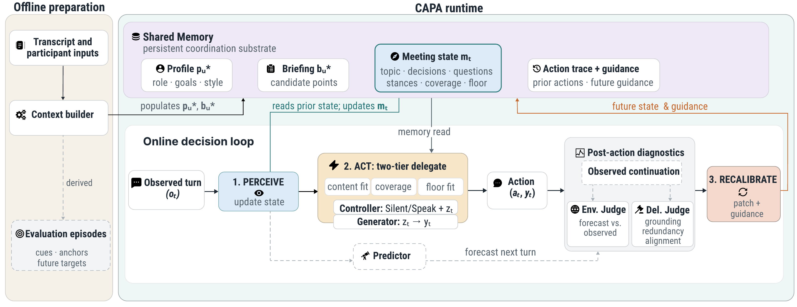
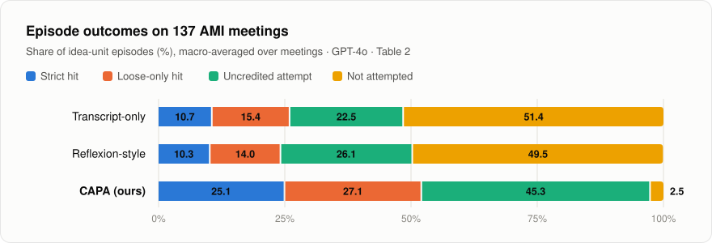

<div align="center">

# Speak for Me
### Giving LLMs the Situational Awareness to Participate in a Meeting

**Muneeb Khan**\* · **Frederic Kirstein**\* · Terry Ruas · Bela Gipp

University of Göttingen, Germany<br>
<sub>\* Equal contribution, alphabetical order</sub>

[](#citation)
[](LICENSE)
[](requirements.txt)
[](data/README.md)

[Overview](#overview) · [Results](#results) · [Quickstart](#quickstart) · [Evaluation](#evaluation) · [Data](#data) · [Citation](#citation)

</div>

<p align="center">
  
</p>

In online meeting delegation, prompt-only LLM delegates often stay silent when they should speak. On the AMI corpus, a transcript-only delegate misses 51.4% of an absent participant's talking opportunities. **CAPA** (Collaborative Agent Predictive Architecture) maintains an explicit meeting state, updates it from each observed turn, acts on it, and corrects it after each action.

<table align="center">
  <tr>
    <td align="center" width="25%"><h3>51.4% → 2.5%</h3><sub>silence rate</sub></td>
    <td align="center" width="25%"><h3>26.1 → 52.2</h3><sub>credited recovery (loose recall)</sub></td>
    <td align="center" width="25%"><h3>38.1 → 63.0</h3><sub>Decision F1</sub></td>
    <td align="center" width="25%"><h3>0.6%</h3><sub>hallucination</sub></td>
  </tr>
</table>
<p align="center"><sub>Transcript-only delegate → CAPA on 137 AMI meetings, GPT-4o backbone.</sub></p>

## Overview

A delegate represents an absent participant *u*⋆ in a meeting that is replayed turn by turn under a strict causal protocol. At each decision point it observes only the dialogue so far and chooses **SILENT** or **SPEAK**. When it speaks, it first commits to a discrete proposition and only then phrases it in the participant's voice.

CAPA runs a *perceive → act → recalibrate* loop over an explicit meeting state *m*<sub>t</sub> that tracks the active topic, decisions, open questions, participant stances, prior coverage, and floor.

| | Module | Role | Code |
|:---:|---|---|---|
| 🗂️ | **Shared Memory** | Participant profile *p*<sub>u</sub>, session briefing *b*<sub>u</sub>, meeting state *m*<sub>t</sub>, action trace and guidance | [`shared_memory.py`](src/shared_memory.py) |
| 👁️ | **Perceiver** | Estimates the meeting state *m*<sub>t</sub> from the observed dialogue | [`environment_interpreter.py`](src/environment_interpreter.py) |
| 🎯 | **Controller** | Decides SILENT/SPEAK and commits to a proposition *z*<sub>t</sub>, with a candidate curator, a coverage evaluator, and a speaker scorer | [`two_tier_agent.py`](src/two_tier_agent.py) |
| 💬 | **Generator** | Realizes *z*<sub>t</sub> as an utterance in the participant's style | [`two_tier_agent.py`](src/two_tier_agent.py) |
| 🔭 | **Predictor** | Forecasts the next turn; the forecast is hidden from the action policy and scored after the action | [`capa/predictor.py`](src/capa/predictor.py) |
| ⚖️ | **Environment Judge** | Forecast vs. observed continuation (perception error) | [`capa/judge.py`](src/capa/judge.py) |
| ⚖️ | **Delegate Judge** | Action vs. observed continuation: grounding, redundancy, alignment (action error) | [`capa/delegate_judge.py`](src/capa/delegate_judge.py) |
| 🔄 | **Recalibrator** | Fuses both verdicts into a state patch plus guidance for the next decision | [`capa/recalibrator.py`](src/capa/recalibrator.py) |
| 📋 | **Offline preparation** | Participant profile, session briefing, and evaluation episodes | [`user_profile_generator.py`](src/user_profile_generator.py), [`jit_briefing_generator.py`](src/jit_briefing_generator.py) |

> [!NOTE]
> In the code, the Perceiver is the *Environment Interpretation Module (EIM)*, the session briefing is the *JIT briefing*, and the Environment Judge is `CapaJudge`. [`docs/architecture.md`](docs/architecture.md) maps every paper component to its code, walks through one decision step, and lists where each prompt from Appendix J lives.

## Results

<p align="center">
  <picture>
    <source media="(prefers-color-scheme: dark)" srcset="assets/outcomes-dark.svg">
    
  </picture>
</p>

| System | Strict recall ↑ | Loose recall ↑ | Uncredited | Not attempted ↓ | Decision F1 ↑ | Hallucination ↓ |
|---|:---:|:---:|:---:|:---:|:---:|:---:|
| Transcript-only (Hu et al., 2025) | 10.7 | 26.1 | 22.5 | 51.4 | 38.1 | 1.5 |
| Reflexion-style | 10.3 | 24.3 | 26.1 | 49.5 | 47.6 | 0.3 |
| **CAPA (ours)** | **25.1** | **52.2** | 45.3 | **2.5** | **63.0** | 0.6 |

<sub>Table 2 of the paper: 137 AMI meetings, GPT-4o, N = 20, k = 5, macro-averaged %. For each system, the strict, loose-only (loose minus strict), uncredited, and not-attempted rates sum to 100% of idea-unit episodes. CAPA's redundancy rate is 0.0%.</sub>

**Further findings**

- 🧠 **The meeting state drives the gain** (Table 8, 20 matched meetings). The state-ablated variant replaces *m*<sub>t</sub> and recalibration with a 50-turn raw window. Against it, CAPA raises loose recall from 28.1 to 50.5 and Decision F1 from 36.4 to 61.1, and lowers redundancy from 10.7 to 0.0.
- 🔄 **Recalibration affects what is said rather than whether to speak** (Table 9). Without it, loose recall falls from 53.7 to 49.8 and uncredited attempts rise from 46.3 to 49.8. Decision F1 stays level (66.2 with recalibration, 66.7 without; overlapping CIs).
- 🔀 **The architecture carries over to other backbones** (Table 16). Across GPT-4o, Gemini-2.5-Pro, Llama-3.3-70B, and Qwen3.6-27B, Decision F1 ranges from 57.9 to 69.2, and each backbone settles at its own coverage–precision balance.
- 🏛️ **It carries over to a second corpus** (Table 12). On 10 ICSI research meetings, CAPA reaches a 1.2% not-attempted rate, 73.6 loose recall, and 64.8 Decision F1.
- 📐 **Sensitivity to N and k** (Tables 15 and 17). Across raw windows N ∈ {10, 20, 30}, loose recall stays between 50.5 and 56.7 and Decision F1 between 61.1 and 63.1. Widening the evaluation window from k = 3 to k = 9 raises loose recall from 43.9 to 62.7 and lowers Decision F1 from 75.3 to 54.5.

## Quickstart

### 1. Install

You need Python ≥ 3.10, `bash`, and an API key for at least one supported provider.

```bash
git clone https://github.com/FKIRSTE/emnlp2026-meeting-delegation.git
cd emnlp2026-meeting-delegation

python -m venv .venv
source .venv/bin/activate
pip install -r requirements.txt

cp .env.example .env               # then add your API key(s)
python scripts/check_llm_setup.py  # optional: one live call to verify credentials
```

Run all commands from the repository root.

<details>
<summary><b>Configuring backbones</b></summary>
<br>

Model aliases are defined in [`src/config_extended.json`](src/config_extended.json). Credentials are read from environment variables, which can be set in `.env`. Select an alias with `--model <alias>` on any entry point, or with `MD_ACTIVE_MODEL`.

| Alias | Provider | Model | Environment variables |
|---|---|---|---|
| `gpt-4o-openai` *(default)* | OpenAI | `gpt-4o` | `OPENAI_API_KEY` (optional `OPENAI_BASE_URL`) |
| `gpt-5-mini-openai`, `gpt-5-openai` | OpenAI | `gpt-5-mini`, `gpt-5` | `OPENAI_API_KEY` |
| `gpt-4o`, `gpt-5-mini` | Azure OpenAI | `gpt-4o`, `gpt-5-mini` | `AZURE_OPENAI_API_KEY`, `AZURE_OPENAI_ENDPOINT`, `AZURE_OPENAI_API_VERSION` |
| `gemini` | Google GenAI | `gemini-2.5-pro` | `GEMINI_API_KEY` |
| `llama-3.3-groq` | Groq | `llama-3.3-70b-versatile` | `GROQ_API_KEY` |
| `qwen-3.6-groq` | Groq | `qwen/qwen3.6-27b` | `GROQ_API_KEY` |

The paper used the snapshots GPT-4o `2024-11-20`, Gemini-2.5-Pro `2025-06-17`, Llama-3.3-70B `2024-12-06`, and Qwen3.6-27B `2026-04-21` (Table 4). To use the same snapshots, set them in the alias's `"model"` field, e.g. `"gpt-4o-2024-11-20"`. To add a provider, add an alias with the same fields.

</details>

### 2. Run CAPA on a meeting

```bash
# Smoke test: the first 150 utterances of one meeting
scripts/run_experiment_variants.sh single \
  --input data/ami/test/Meeting33test_parsed.json \
  --output-root results/smoke \
  --debug-max-utterances 150

# A full meeting
scripts/run_experiment_variants.sh single \
  --input data/ami/test/Meeting32test_parsed.json \
  --output-root results/demo
```

Each run executes three stages, and re-running the same command resumes from completed work:

| Stage | Entry point | What it does |
|:---:|---|---|
| 1 | `src/data_pipeline.py` | Builds participant profiles, session briefings, idea-unit episodes, and Perceiver states |
| 2 | `src/participant_simulation.py` | Replays every episode causally: perceive, act, predict, judge, recalibrate |
| 3 | `scripts/capa_eval.py` | Scores whether, when, and what the delegate contributed (no LLM calls) |

<details>
<summary><b>Output layout</b></summary>
<br>

```text
results/demo/
├── _prep/Meeting32test/            # Stage 1: preparation
│   ├── user_profiles/              #   participant profiles p_u
│   ├── jit_briefings/              #   session briefings b_u
│   ├── capa_episodes/              #   evaluation episodes (cue, anchor, idea units)
│   ├── capa_eim_states/            #   Perceiver states
│   └── prep_manifest.json
└── capa/Meeting32test/             # Stages 2–3: simulation and evaluation
    ├── capa_sim_<participant>_Meeting32test.json
    ├── artifacts/                  #   per-step traces: state, plan, utterance, judge verdicts
    ├── evals/Meeting32test/        #   step / episode / idea-unit / meeting metrics
    └── pipeline_status.json, simulation_manifest.json, eval_manifest.json, pipeline.log
```

</details>

### 3. Aggregate

```bash
# Corpus means with 95% bootstrap CIs (B = 10,000)
python scripts/aggregate_corpus.py --root results/demo/capa

# All 137 meetings, resumable
scripts/run_experiment_variants.sh batch \
  --input-dirs data/ami/test,data/ami/val,data/ami/train \
  --output-root results/ami
```

📖 All flags: [`docs/cli_reference.md`](docs/cli_reference.md) · Ablations, sensitivity studies, other backbones: [`docs/experiments.md`](docs/experiments.md)

<details>
<summary><b>Repository structure</b></summary>
<br>

```text
.
├── src/                          # CAPA runtime
│   ├── data_pipeline.py          #   Stage 1 CLI: profiles, briefings, episodes, Perceiver states
│   ├── participant_simulation.py #   Stage 2 CLI: causal replay for one participant
│   ├── two_tier_agent.py         #   Controller + helpers + Generator (CAPA delegate)
│   ├── environment_interpreter.py#   Perceiver (EIM)
│   ├── shared_memory.py          #   Shared Memory
│   ├── raw_agents.py             #   Transcript-only / Reflexion-style / state-ablated baselines
│   ├── llm_client.py, config.py  #   Provider wrapper and model configuration
│   ├── config_extended.json      #   Model aliases (no secrets; keys come from .env)
│   ├── capa/                     #   Predictor, judges, Recalibrator, loop driver, episode construction
│   └── evals/                    #   Metric loading and computation
├── scripts/                      # Entry points: run, evaluate, aggregate, analysis studies
│   ├── run_experiment_variants.sh#   Recommended wrapper (single meeting or batch, several variants)
│   ├── run_meeting_pipeline.py   #   One meeting: prep → simulation → evaluation
│   ├── run_batch_meetings.py     #   Many meetings, resumable
│   ├── capa_eval.py              #   Stage 3: per-meeting metrics
│   ├── aggregate_corpus.py       #   Corpus means with 95% bootstrap CIs
│   ├── k_window_study/           #   Evaluation-window (k) sensitivity study
│   └── context_window_study/     #   Anchor freezing for the raw-window (N) study
├── data/ami/                     # 137 parsed AMI meetings (train / val / test) + manifests
├── docs/                         # Architecture, experiment commands, CLI reference
└── assets/                       # Figures used in this README
```

[`scripts/README.md`](scripts/README.md) lists every script.

</details>

## Evaluation

The first 60% of a meeting builds the participant profile; the remaining 40%, the interaction segment, is the evaluation testbed. There, an LLM selector extracts the participant's **idea units**: proposition-level claims, proposals, or decision-relevant facts they actually introduced. Each idea unit defines an **episode** with two reference points:

- **Cue**: the information boundary at which the delegate must act.
- **Anchor**: the turn where the participant actually voiced the idea.

The delegate makes a SILENT/SPEAK decision at each of the *k* = 5 steps after the cue, seeing only causally observed context. A contribution earns credit only if it matches the target proposition and is neither hallucinated nor redundant. Each episode resolves into exactly one outcome:

| Outcome | Definition | Output key |
|---|---|---|
| 🟦 Strict hit | Credited match at the anchor (Δ = 0) | `idea_strict_recall_rate` |
| 🟧 Loose-only hit | Credited match within the *k*-turn window, but not at the anchor | `idea_loose_only_rate` |
| 🟩 Uncredited attempt | Spoke, but failed a credit criterion | `idea_bad_attempt_rate` |
| 🟨 Not attempted (*silence rate*) | Silent throughout the episode | `idea_ignored_rate` |

Loose recall (*credited recovery*) is strict plus loose-only (`idea_loose_recall_rate`). All metrics are computed per meeting and macro-averaged with 95% percentile-bootstrap CIs.

<details>
<summary><b>All metrics and their output keys</b></summary>
<br>

| Metric (paper) | Output key |
|---|---|
| Decision F1 (speak vs. silent at idea anchors) | `gt_idea_action_f1_micro` |
| Hallucination / redundancy / off-topic (per spoken turn) | `hallucination_rate_speaks`, `redundancy_rate_speaks`, `off_topic_rate_speaks` |
| Matched-unit rate | `matched_unit_rate` |
| Decision / context appropriateness, relevance, grounding (0–100) | `delegate_{decision,context}_appropriateness_mean`, `delegate_relevance_mean`, `delegate_grounding_mean` |
| Anchor-relative lead time | `idea_latency_{mean,median}`, `idea_match_{synchronized,proactive}_rate` |

Corpus-level values are written to `aggregated_evals/paper_metrics.csv` by `scripts/aggregate_corpus.py`. Per-step, per-episode, and per-idea-unit tables sit next to each meeting's `meeting_metrics.json`.

</details>

### Baselines and ablations

The baselines and ablations run through the same pipeline as CAPA, with the same participant context, episodes, judges, and backbone. Select them with `--variants`:

| System | `--variants` |
|---|---|
| Transcript-only delegate (Hu et al., 2025, reimplemented) | `mono-raw` |
| Reflexion-style baseline | `mono-raw-reflection` |
| State-ablated CAPA (Table 8) | `raw-modular` |
| CAPA without recalibration (Table 9) | `capa` with `--no-recalibration` |

The raw-transcript systems see a 50-turn window (`--raw-context-N`) in place of the meeting state.

## Data

[`data/ami/`](data/ami/) contains all **137 AMI scenario meetings** (Carletta et al., 2005) as parsed JSON transcripts, taken from the AMI portion of QMSum (Zhong et al., 2021): 97 train, 20 validation, and 20 test meetings. The paper evaluates on the full pool. Each file is a chronologically ordered list of utterances:

```json
[
  {"utterance_id": "Meeting28_001", "speaker_id": "Project Manager", "utterance_content": "..."}
]
```

To run CAPA on your own meetings, provide transcripts in this format; `scripts/convert_csv_to_json.py` converts speaker-labelled CSV exports. Provenance, statistics, and licensing: [`data/README.md`](data/README.md).

## Responsible use

> [!IMPORTANT]
> Deploying state-conditioned delegation in a live meeting requires **explicit, recurring consent from everyone present**. The agent can surface a participant-owned proposition that the represented participant may not have stated themselves. Misuse paths include impersonation under false pretenses, speech laundering through plausible deniability, and an asymmetric advantage for represented over unrepresented participants.

## Citation

If you use this code, the evaluation protocol, or the parsed data, please cite:

```bibtex
@inproceedings{khan-etal-2026-meetingdelegation,
  address   = {Budapest, Hungary},
  author    = {Khan, Muneeb and Kirstein, Frederic and Ruas, Terry and Gipp, Bela},
  booktitle = {The 2026 Conference on Empirical Methods in Natural Language Processing},
  month     = {oct},
  publisher = {Association for Computational Linguistics},
  title     = {Speak for Me: Giving LLMs the Situational Awareness to Participate in a Meeting},
  year      = {2026}
}
```

If you use the AMI transcripts, please also cite the AMI Meeting Corpus and QMSum (see [`data/README.md`](data/README.md)).

## License

Code: [MIT License](LICENSE). The AMI Meeting Corpus is distributed under [CC BY 4.0](https://creativecommons.org/licenses/by/4.0/); see [`data/README.md`](data/README.md) for data attribution.

## Acknowledgements

This work was supported by the Lower Saxony Ministry of Science and Culture and the VW Foundation.
